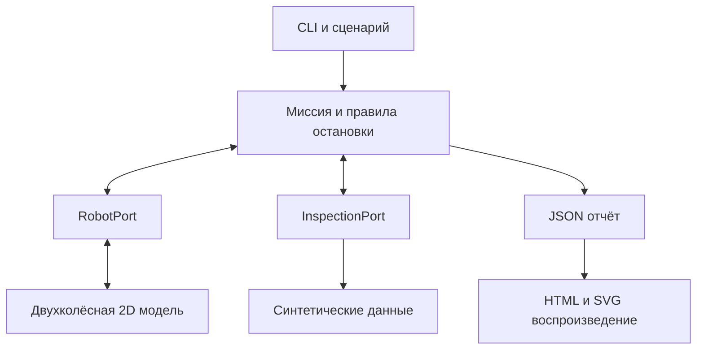

# Архитектура SCOUT-01

## Действующее правило Solentica Tech — 06.11.2026

[ARCH-SCOUT-SKILLFORGE-01](decisions/ARCH-SCOUT-SKILLFORGE-01.md) закрепляет
владение компонентами, обязательную проверку команд и границы будущих изменений.
Scout — конкретный робот-инспектор и его система исполнения; SkillForge —
лаборатория алгоритмов/навыков. В integrated run физикой, clock/advance,
миссионным бюджетом, инспекцией и независимым stop владеет Scout.

Описание SCOUT-01 ниже сохраняется как документация исходного цифрового стенда.
Актуальный внешний контроллер подключён в [route-bridge](integration/route-bridge.md).
Существующие baseline, физика и CV не удаляются этим решением. Аппаратные
адаптеры и проверенная физическая остановка пока не реализованы.

Цель — проверить полный цифровой цикл лабораторной инспекции на CPU: заданный
маршрут, три точки, подготовленные отклонения и воспроизводимый отчёт.
Текущая версия использует только стандартную библиотеку Python.

## Разделение ответственности

| Модуль | Ответственность |
| --- | --- |
| models.py | Неизменяемые структуры, геометрия, валидация, SHA-256 сценария |
| ports.py | Контракты привода, телеметрии и инспекции |
| simulator.py | Кинематика, дальномер, шум, защита габарита |
| mission.py | Порядок точек, наведение, остановки, журнал и метрики |
| report.py | Атомарная запись JSON и автономного HTML |
| __main__.py | Аргументы, выбор сценария, коды завершения |

Контроллер знает координаты целей и получает позу/дальность через RobotPort.
Для решений о движении он не читает прямоугольники мира. В SCOUT-01 истинная поза
симулятора передаётся как идеализированная телеметрия. Модель одометрии и ArUco
относятся к следующему этапу.

## Геометрия и движение

Оси карты: X вправо, Y вверх; направление измеряется против часовой стрелки от X.
Все расстояния — в метрах, углы — в радианах. Кинематика:
v = wheel_radius × (right + left) / 2;
omega = wheel_radius × (right − left) / axle_track.
Скорости колёс измеряются в рад/с.

Круговой габарит покрывает колёса. Вращение на месте не меняет его контур.
Робот поворачивается до допуска по направлению и затем движется вперёд;
при новом отклонении снова выравнивается. Движение назад отключено.

Дальномер пересекает луч движения с препятствиями, расширенными на радиус робота,
и с границами полигона. Это консервативный запас хода до контакта габарита.
Около углов прямоугольников робот может остановиться раньше необходимого.

Дополнительная геометрическая защита проверяет весь шаг: дуга разбивается на
короткие отрезки, расширение учитывает отклонение дуги от хорды.
Пересечение отклоняет весь шаг с причиной FOOTPRINT_GUARD.
Штатное препятствие должно быть замечено дальномером раньше.
Ноль simulated_contacts означает отсутствие разрешённых пересечений в модели;
collision_guard_activations показывает обращения к последнему рубежу защиты.

## Миссия и остановки

Состояния: PRECHECK, ALIGN, NAVIGATE, INSPECT, RETURN и терминальный статус.
Сначала проверяются доступность, конечность и возраст телеметрии, затем допускается
новая команда. Число шагов ограничено. Блокировка завершает миссию без объезда.

У точки отправляется остановка, затем вызывается источник инспекции.
Подготовленные отклонения возвращаются с source = scenario_fixture и synthetic = true.
В отчёте явно указано computer_vision_executed = false.
Непосещённые точки не получают фиктивной инспекции «норма».

Остановка вызывается в finally, включая исключения адаптера. Нулевая скорость
дополнительно подтверждается телеметрией. Если подтверждения нет, итог — FAULT.
Необработанное исключение внешнего адаптера останавливает привод и передаётся
вызывающему коду; оно не превращается в успешный отчёт.

В SCOUT-01 нет сервера, сетевых команд и фоновой миссии. HTML воспроизводит уже
завершённый расчёт. Проверка потери сетевого оператора будет нужна при добавлении
живого управления; в текущей версии она не заявляется.

## Воспроизводимость

По умолчанию шаг равен 0,05 модельной секунды. Прогон не использует системные часы,
сон, сеть и глобальный RNG. Локальный генератор с seed задаёт шум дальномера.
Хеш включает нормализованные параметры и значения по умолчанию.
Версия реализации записывается в отчёт; для экспериментов сохраняйте ревизию Git.

Одинаковые входы и версия на одной платформе дают побайтово одинаковый JSON.
Межплатформенная идентичность тригонометрии не обещается; CI проверяет смысловые
исходы на Windows и Linux.

## Будущие аппаратные адаптеры

| Расширение | Точка подключения | Дополнительная работа |
| --- | --- | --- |
| Камера и детектор | InspectionPort и отдельный исполнитель | Калибровка, качество кадра, файлы доказательств, INCONCLUSIVE |
| Моторы и энкодеры | RobotPort | USB-протокол, обратная связь, подтверждение остановки |
| Дальномеры | Телеметрия RobotPort | Метки времени, устаревание, проверка слепых зон |
| Реальное время | Новый планировщик вместо advance(dt) | Монотонные часы, дедлайны, команды с TTL |
| Независимая остановка | MCU и аппаратная цепь | Watchdog, EN по умолчанию выключен, аварийная кнопка и испытания |

advance(dt) — контракт цифрового стенда. Замена его на sleep не делает адаптер
пригодным для физического робота. Исполнитель SCOUT-01 отклоняет несинтетические
доказательства, чтобы не выдать данные камеры за подготовленные данные.
При расширении нужны отдельный режим исполнения и корректный источник доказательств.

SkillForge не является зависимостью. Подключение его алгоритмов позже возможно
через адаптер после проверки доступности и лицензий.

## Приёмка

Тесты подтверждают цифровую модель, остановки, сценарии и отчёты.
Они не оценивают качество настоящего зрения, проходимость шасси и тормозной путь.
Серия из 20 seed отделена от будущих 20 физических обходов.
